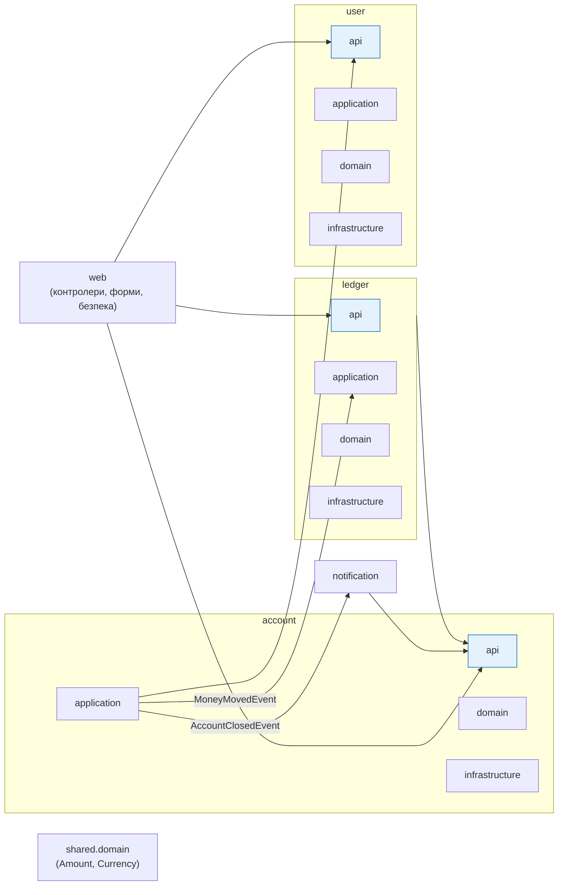

# Архітектура MBA Bank 2.0

## 1. Вихідний стан (версія 1.0)

Шаровий моноліт з організацією «пакет за технічним шаром»:

```
controller ──► service ──► repository ──► model/jpaentity
     └──────────────────────► repository   (обхід сервісного шару)
```

- `DashboardController` і `AdminController` працюють з `UserRepository` напряму.
- У шаблони передаються JPA-сутності (`TransactionEntity`, `UserEntity` разом із хешем пароля).
- Бізнес-правила (залишок, власність рахунку) розпорошені по сервісу або відсутні.
- Немає жодного активного автотесту (`contextLoads` вимкнено через Managed Identity).

## 2. Цільова архітектура: модульний моноліт



| Модуль | Відповідальність | Залежить від |
|---|---|---|
| `shared` | Value Objects `Amount`, `Currency`, базовий `DomainException` | — |
| `user` | Користувачі, ролі, автентифікація, адміністрування доступу | `shared` |
| `account` | Рахунки, поповнення, зняття, перекази, закриття | `shared`, `user.api` |
| `ledger` | Незмінний журнал операцій та виписки | `shared`, `account.api` (події) |
| `notification` | Листи адміністратору | `account.api` (події) |
| `web` | Контролери, форми, шаблони, безпека | `*.api` |

Правила (перевіряються `ModuleArchitectureTest` під час кожної збірки):

1. Модуль звертається до іншого модуля лише через його пакет `api`.
2. Жоден модуль не залежить від `web`; `shared` не залежить від модулів.
3. Доменний шар не залежить від Spring і Servlet API.
4. `api` не посилається на внутрішні шари свого модуля.
5. Контролери не працюють з репозиторіями та JPA.
6. Граф залежностей між модулями ациклічний.

## 3. Записи архітектурних рішень (ADR)

### ADR-001. Модульний моноліт замість мікросервісів
**Контекст.** Застосунок невеликий (≈700 рядків Java), розгорнутий на одній ВМ Azure, одна БД.
**Рішення.** Виділити модулі всередині одного процесу з контрактами `api` і доменними подіями.
**Наслідки.** Зберігаються ACID-транзакції та простий деплой. Межі модулів формалізовано, тож за потреби будь-який модуль можна винести в окремий сервіс: для `ledger` чи `notification` достатньо замінити синхронну подію на брокер повідомлень.

### ADR-002. Насичена доменна модель і Value Object `Amount`
**Контекст.** Перевірки суми та залишку були неповні: 0.005 мовчки округлювалося, валюта була довільним рядком.
**Рішення.** Інваріанти рахунку живуть в агрегаті `Account`, правила суми — в `Amount`, валюти — в enum `Currency`.
**Наслідки.** Правила тестуються без Spring і БД. Невалідні дані відхиляються до будь-яких змін стану.

### ADR-003. Песимістичне блокування рядка рахунку + `@Version`
**Контекст.** Зонд T7 у версії 1.0: 20 паралельних зняттів по 100 з балансу 1000. Система записала 20 операцій (2000), а баланс зменшився лише на 700 (втрачені оновлення й перевитрата).
**Рішення.** `SELECT … FOR UPDATE` (`@Lock(PESSIMISTIC_WRITE)`) для всіх змін балансу. Під час переказу рахунки блокуються за зростанням id, щоб уникнути взаємоблокувань. `@Version` додає оптимістичний захист.
**Наслідки.** У версії 2.0 той самий тест дає рівно 10 успішних зняттів і баланс 0.

### ADR-004. Журнал операцій через доменну подію
**Контекст.** `AccountService` напряму працював із `TransactionRepository`, а видалення рахунку стирало його історію.
**Рішення.** `account` публікує `MoneyMovedEvent`; `ledger` записує подію в тій самій транзакції (`@EventListener` + `Propagation.MANDATORY`). Записи журналу незмінні (`updatable = false`). Рахунки закриваються «м'яко» (статус `CLOSED`).
**Наслідки.** Атомарність «баланс + журнал» збережено, а `account` не знає про `ledger`. Історія операцій не втрачається.

### ADR-005. Сповіщення після коміту, адреса з конфігурації
**Контекст.** Адреса отримувача листа приходила з прихованого поля форми, а надсилання блокувало запит.
**Рішення.** `@TransactionalEventListener(AFTER_COMMIT)` + `@Async`. Адреса задається в `mba.notifications.admin-email`.
**Наслідки.** Лист не надсилається для відкоченої операції. Підмінити отримувача неможливо, а SMTP не впливає на час відповіді.

### ADR-006. Конфігурація без секретів, профілі local/prod
**Контекст.** Пароль застосунку Gmail і параметри Azure SQL зберігалися у `application-prod.yml` у Git. Профіль `prod` був активний за замовчуванням, тож локальний запуск і тести були неможливі.
**Рішення.** Профіль `local` (H2, демо-користувачі) за замовчуванням. У `prod` усі значення беруться зі змінних середовища.
**Наслідки.** `./mvnw spring-boot:run` працює одразу після клонування, тести запускаються в CI.

### ADR-007. Збереження сумісності схеми БД
**Рішення.** Назви таблиць і наявних стовпців не змінено (`accounts.type` → поле `label`, `transactions.user_id` → `actorId`). Нові стовпці додаються зі значеннями за замовчуванням (див. `docs/migration-v2.sql`).
**Компроміс.** Між модулями немає JPA-зв'язків, тож на новій БД Hibernate не створює зовнішніх ключів. У продуктивній БД наявні FK зберігаються, а міграційний скрипт їх не видаляє.
